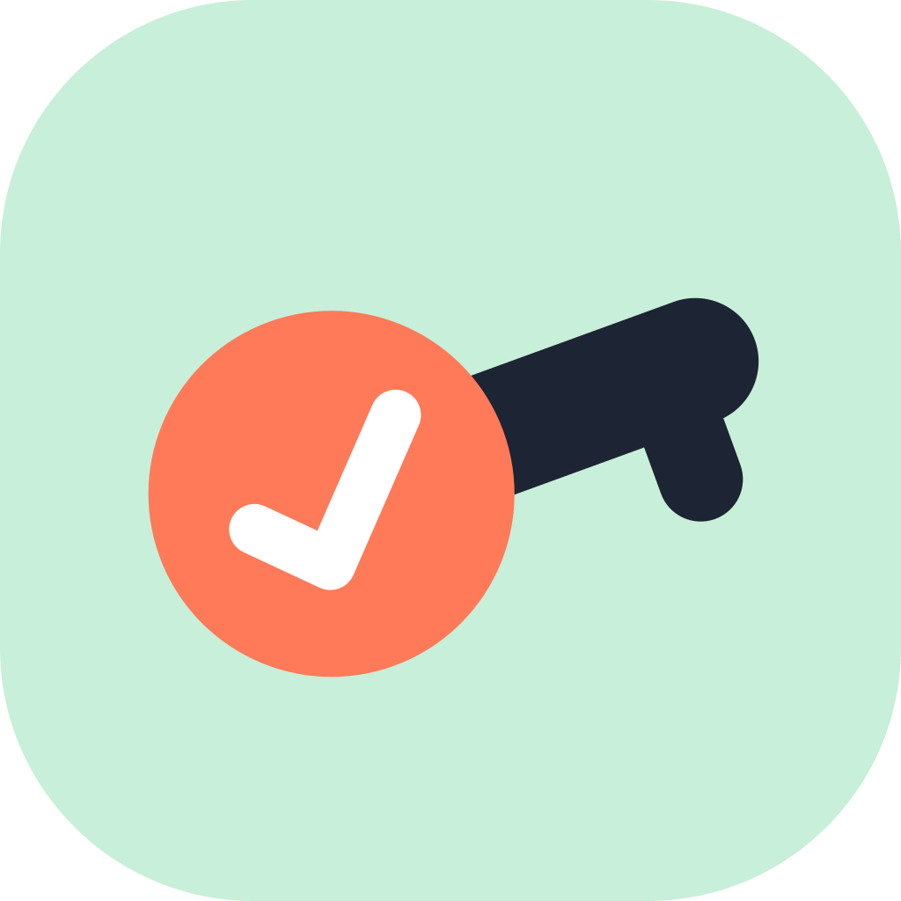
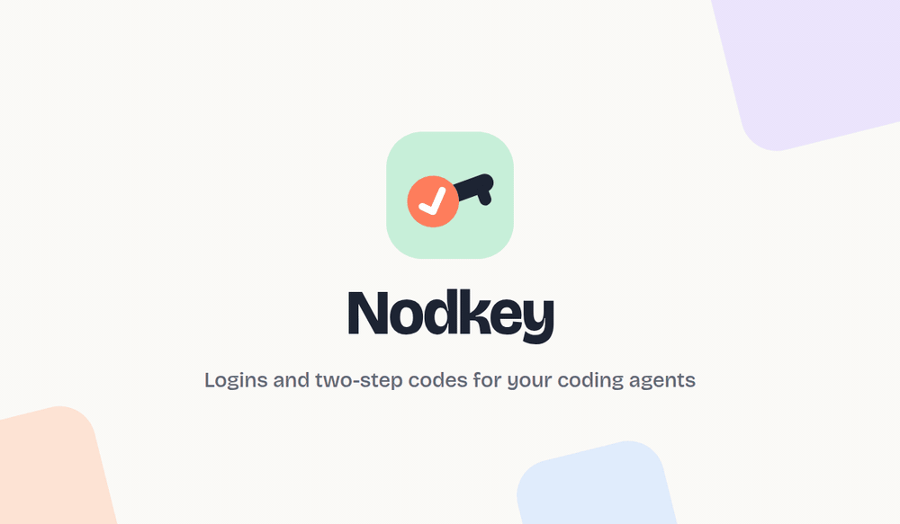
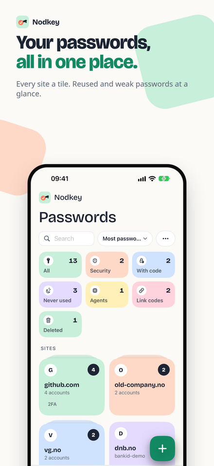
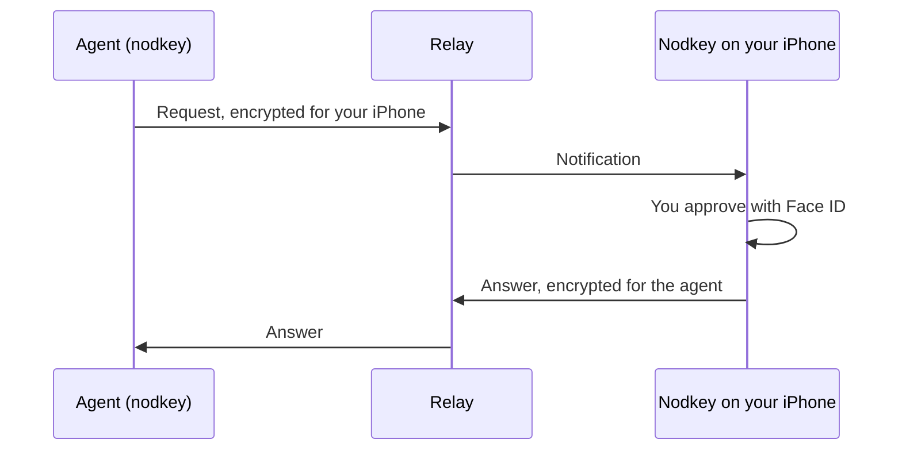

<p align="center">
  
</p>

<h1 align="center">nodkey</h1>

<p align="center">
  Let your coding agents ask your iPhone for a login or a two-step code.<br>
  You approve every request with Face ID.
</p>

<p align="center">
  <a href="https://github.com/peters/nodkey-cli/actions/workflows/ci.yml"></a>
  <a href="LICENSE"></a>
</p>

<p align="center">
  <a href="https://apps.apple.com/app/id6820952672"></a>
</p>

<p align="center">
  
</p>

`nodkey` lets you and your coding agents ask [Nodkey](https://kh-labs.dev/nodkey/) on your iPhone
for **one** one-time code or **one** login at a time. Every request shows up on your phone, and
nothing leaves it until you approve with Face ID (or a lease you set answers for you). The relay in
the middle only forwards encrypted messages.

One small binary does two jobs:

- **A command line** for your terminal and your scripts: `nodkey code`, `nodkey login`, ...
- **An MCP server** for coding agents: `nodkey mcp`. `nodkey setup` adds it to Claude Code, Codex,
  Cursor and Claude Desktop, together with a skill that teaches them how to use it.

Each agent pairs with its own name ("Claude Code @ my-laptop", "Codex @ my-laptop",
"Terminal @ my-laptop"). In Nodkey you see who asked for what, and you can pause or remove one agent
without touching the others.

## Meet Nodkey

<p align="center">
  
  
  
  
</p>

[Nodkey](https://apps.apple.com/app/id6820952672) is a free password manager and authenticator for
iPhone:

- **Passwords, two-step codes and passkeys** behind Face ID, filled in with AutoFill in Safari and
  apps.
- **Agents sign in, you decide.** You see who asks, for which site and why, and approve with Face
  ID. Lend an account for a day or a week, pause an agent, or stop all agents with one tap.
- **Move in in minutes** from Apple Passwords, 1Password, Bitwarden, Chrome, Firefox and more.
  Export everything again at any time.
- **Backed up in your own iCloud**, end-to-end encrypted.
- **No account, no ads, no tracking.** In 12 languages.

## How it works



The relay forwards sealed messages and sends the notification. It cannot read a code, a password,
an account name or the reason. It sees the IP address your computer connects from: it keeps that
address and its country with the request, so your iPhone can show where the request came from, and
deletes them with the request (after 2 minutes, up to 6 for an SMS code).

## What you need

- An iPhone with iOS 18 or later and [Nodkey](https://apps.apple.com/app/id6820952672) 1.3 or later
  from the App Store (free).
- Linux, macOS or Windows for `nodkey`.

## Install

```sh
curl -fsSL https://raw.githubusercontent.com/peters/nodkey-cli/main/install.sh | sh
```

On Windows (PowerShell):

```powershell
irm https://raw.githubusercontent.com/peters/nodkey-cli/main/install.ps1 | iex
```

Or build it with Rust 1.85 or newer:

```sh
cargo install --locked --git https://github.com/peters/nodkey-cli nodkey
```

The binaries are static (Linux x64 and arm64, macOS arm64 and x64, Windows x64). macOS binaries are
signed and notarized. TLS uses rustls, so no OpenSSL is needed.

The install scripts take the newest stable release (`NODKEY_VERSION=vX.Y.Z` picks another one) and
check the archive against `SHA256SUMS`. When the GitHub CLI (`gh`) is installed and logged in, they
also check the build provenance: `gh attestation verify` shows that the release workflow of this
repository built the archive. When `gh` cannot reach GitHub, they download without it and check
the checksum only. On macOS they check the Developer ID signature of the binary instead, because it
is signed after the build. To check an archive yourself:
`gh attestation verify nodkey-x86_64-unknown-linux-musl.tar.gz --repo peters/nodkey-cli`.

## Set up your agents

```sh
nodkey setup            # add the MCP server and the skill to every agent it finds
nodkey setup --dry-run  # show what it would change
nodkey setup --remove   # take it all away again (your pairings stay)
```

`setup` uses `claude mcp` and `codex mcp` for Claude Code and Codex, edits `~/.cursor/mcp.json`
and Claude Desktop's `claude_desktop_config.json`, and writes the skills (`nodkey` and `nodkey-move-in`) to `~/.claude/skills`,
`~/.codex/skills` and `~/.agents/skills` (only for the folders that exist). Agents that are not
installed are skipped. A changed config file keeps its permissions (a new one only you can read),
and a config file that is a symlink stays one. Restart the agents afterwards, then ask each one to
pair with Nodkey.

Any other MCP client can start the server itself:

```json
{ "mcpServers": { "nodkey": { "command": "nodkey", "args": ["mcp", "--agent", "my-agent"] } } }
```

## Pair

```sh
nodkey pair
```

It shows a code like `K7P-2QX`. In Nodkey, open **Agents**, tap **Add agent** and type the code.
Then `nodkey pair` shows a check number like `418 902`, and so does your iPhone. Compare the two
numbers. When they are the same, type `y` in the terminal and confirm on your iPhone too; only then
is the pairing saved. When they are not the same, the pairing messages may have been changed on
the way: say no on both sides, and nothing is saved.

An agent pairs the same way with its `pair` tool: it shows you the code, then the check number, and
asks you whether your iPhone shows the same number.

Each side makes a random value for the check number, and the iPhone commits to its value before it
sees the computer's. So the relay that passes the keys cannot pick keys that give the same number
on both screens. After pairing, every request and every answer is signed by the side that sent it,
inside the encryption. This needs Nodkey 1.3 or later on your iPhone; an older app gets a message
to update it.

## First-time import with an agent

Bring the passwords and codes from your browsers and password managers into Nodkey, and let your
agent do the legwork. This needs Nodkey 1.4 or later on your iPhone.

1. On your iPhone, open Nodkey, then **Settings → Import → From your computer, with an agent**.
   Pick your agent and confirm with Face ID. The window stays open for 30 minutes and takes up to
   20 files.
2. Ask your agent to help. It finds the browsers and password managers on this computer, shows you
   how to export from each one, sends each file to Nodkey and deletes it right after.
3. On your iPhone, look through everything under **To review** and add it with one Face ID.

Paste this into Claude Code (or another agent with the nodkey skills):

> Help me move all my passwords and codes into Nodkey. Use the nodkey-move-in skill: find my
> browsers and password managers, guide me through each export, send each file to Nodkey and
> delete it afterwards. Never show or read the passwords yourself.

How your passwords stay safe on the way:

- Only each app's own export is used. The agent never opens a browser's password database.
- The agent never reads an export file. Only `nodkey import` (the `import_file` tool) touches it:
  it encrypts the file for your iPhone, sends it, then overwrites it and deletes it. It shows
  counts, never a password.
- The window only takes files in. The agent gets counts back, never a password or a code, and
  nothing is added until you have looked at it on your iPhone.
- Without an open window your iPhone turns every file away, so no agent can add logins unasked.
- One file is at most 1 MiB, and one window takes at most 20 files.

You can also do it by hand:

```sh
nodkey import ~/Downloads/"Chrome Passwords.csv" --dry-run   # what the file holds; nothing is sent
nodkey import ~/Downloads/"Chrome Passwords.csv" --source "Chrome, profile Default"
```

`--keep` leaves the file where it is.

## Use it from the terminal

```sh
nodkey code github.com/alex --reason "Merge PR #42" --field code
nodkey login vg.no --reason "Check my subscription"
nodkey pay shop.example.com 499 NOK --reveal --reason "Buy the cable I asked for"
nodkey suggest example.com --kind federated --provider google --reason "Signed in with Google"
nodkey sms-code account.example.com --reason "The site sent a code by SMS" --field code
nodkey run -- npm test                       # the keys the .nodkey file lists
nodkey run --secret OPENAI_API_KEY --reason "Run the API tests" -- npm test
printf %s "$NEW_KEY" | nodkey secret save NEW_KEY --service example.com --reason "Save the key I made"
nodkey accounts
nodkey cleanup --ip-only --reason "Remove logins for old router addresses"
nodkey cleanup --query '*.old-company.example' --last-used-before 2022-01-01 --reason "Old job"
nodkey phones
nodkey agents
```

- The target is a site or an issuer, optionally with `/account`: `github.com/alex`, `vg.no`, `GitHub`.
- The reason is shown on your lock screen. Say plainly why.
- `code` and `login` print JSON, or one field with `--field`. `--image FILE` adds a picture (PNG,
  JPEG or GIF, at most 1 MiB) to the notification.
- `cleanup` only proposes. Your iPhone shows the matching logins and you confirm with Face ID. They go
  to Recently deleted, where you can get them back for 30 days.
- `pay` spends money: it asks your iPhone for your card for one purchase, and your iPhone shows the
  shop and the amount. It works only if you turned on "full card number" for that agent in Nodkey,
  and never above the limit you set for it.
- `suggest` only proposes. The method waits in your suggestion list in Nodkey until you accept it
  with one tap. `sms-code` waits for an SMS that your Shortcuts automation passes to Nodkey, and you
  approve it with Face ID.
- `run` gets API keys from Nodkey and gives them only to the command it starts, as environment
  variables. Nothing prints the key, so your agent can use it without seeing it, and no `.env` file
  is needed. `secret save` keeps a new key in Nodkey; it reads the key from stdin, never from the
  command line, and on a terminal the key does not show while you paste it. Your iPhone asks with
  Face ID for every key.
- Keys can belong to projects. A key without a project is global: every project can use it. Put a
  `.nodkey` file in a repository to say which keys it needs. It holds names only, so it is safe to
  commit, also in a public repository:

  ```toml
  project = "sparrow"
  secrets = ["OPENAI_API_KEY", "ANTHROPIC_API_KEY", "global/GITHUB_TOKEN"]
  ```

  `nodkey run -- <command>` in that folder, or below it, asks for all of them at once (one Face ID).
  It looks no higher than the repository root or your home folder, ignores a `.nodkey` that
  someone else owns, and tells you (and your iPhone) which file it used.
  Your iPhone gives the project's key, or else the global key with that name. `--project NAME` asks
  in another project, `--secret NAME` adds a key, and `global/NAME` takes only the global key.
- Exit codes: 0 approved (or queued), 1 error, 2 denied (or rejected), 3 no answer in time, 4 the
  agent is paused, 64 bad arguments. `pay` also has
  5 above your limit, 6 full card numbers off, 7 cards off, 10 no passcode on your iPhone;
  `card-fill` also 8 for a page total above the amount and 9 for cards for later payments that
  are off. `run` exits with the code of the
  command it ran.
- `nodkey webauthn` is for browser hosts such as Horizon: it reads one passkey request (sign in or
  create) as JSON on stdin and writes the result as JSON on stdout. Your iPhone shows the site and
  signs with a passkey that never leaves it. It can also get a secret key from a passkey (the
  WebAuthn PRF extension), for example to unlock a backup; your iPhone asks with Face ID every time
  (`nodkey webauthn --help`). `nodkey login-fill` gives such a host a login to fill a sign-in
  form, only on the login's own website, and the model gets only a summary.
  `nodkey card-fill --agent horizon` gives such a host your card to
  fill a checkout form, so the number goes to the host and not into the agent's conversation. The
  host has its own identity (`nodkey pair --agent horizon`): turn cards on for the host in Nodkey,
  not for the agent. On a page that keeps your card for later payments (a billing page with no
  total), the host can ask to add the card there: your iPhone shows the site and asks with Face ID,
  and only if you turned on "add cards for later payments" for that host. An agent can never do
  this. See `docs/agent-protocol.md`.

`nodkey --help` lists every option.

## MCP tools

| Tool | What it does |
| --- | --- |
| `request_code` | one current one-time code for an account |
| `request_login` | user name and password (and a code, if the login has one); says how you sign in to the site ("Sign in with Google") and can bring that Google login, for Google's own page only |
| `request_credentials` | everything a task needs in one request: up to 10 logins, codes and passkeys; with a session, the rest of the task does not ask again |
| `request_sms_code` | a code the site sent by SMS, passed to Nodkey by your own Shortcuts automation |
| `suggest_sign_in_method` | tell Nodkey how you sign in to a site; it waits in your suggestion list for one tap, no secret |
| `end_session` | end the task session when the task is done |
| `request_secret` | an API key by its variable name or service, in a project or global; the result tells the agent to use `nodkey run` instead, so the key stays out of the chat |
| `save_secret` | keep a key the agent just made (for example in a provider's dashboard) in Nodkey, for its projects or for all |
| `request_payment` | spends money: your card for one purchase at a shop, for an exact amount |
| `list_accounts` | the accounts this agent may ask for, and the names of its keys, without secrets |
| `cleanup_insights` | anonymous numbers to suggest clean-up rules from |
| `cleanup_logins` | propose moving matching saved logins to Recently deleted |
| `import_file` | send a password or code export to the import window you opened on your iPhone; deletes the file afterwards and returns counts only |
| `pair`, `list_phones`, `unpair` | pair this agent, see its phones, leave a phone |

## Settings

| Setting | Default |
| --- | --- |
| Relay: `--relay URL`, else `NODKEY_RELAY`, else `relay` in `config.json` in the agent folder | `https://relay.nodkey.app` |
| Agent identity: `--agent NAME`, else `NODKEY_AGENT` | the command line: the agent whose shell runs it (Claude Code, Codex), else `terminal`; `nodkey mcp`: the MCP client |
| Agent folder: `NODKEY_AGENT_DIR` | `~/.config/nodkey-agent` |
| Where the agent's private keys go: `NODKEY_KEYSTORE`, else `keystore` in `config.json` (`auto` or `file`) | `auto`: the keychain of the system when there is one |
| `NODKEY_REQUEST_TIMEOUT` / `NODKEY_PAIR_TIMEOUT` (seconds) | 120 / 300 |

The relay address must use `https`. Plain `http` works only for a relay on this computer
(`localhost`, `127.0.0.1` or `[::1]`, for tests). `nodkey` does not follow redirects from the relay.

Agent identities name who asks, so the phone shows "Claude Code" for a `nodkey run` that Claude
Code started. They do not separate programs: any program that runs as you can use any identity.
To stop every agent at once, pause all agents under Agents in Nodkey.

The agent folder (only you can open it) holds one folder per agent under `agents/` with its
identity (`identity.json`), paired phones (`phones.json`) and, while one runs, the task session
(`session.json`: its id and end, never a secret). The agent's private keys go to the macOS Keychain,
to the Secret Service on Linux (with `secret-tool` installed), or are sealed with DPAPI for your
Windows user. Where there is no keychain, they stay in `identity.json`. `nodkey agents` shows where
they are.

## Security

- An agent never gets a two-step key, only one code at a time, and a password only for the request
  that asked for it. `nodkey` never writes a code or a password to disk or to a log.
- Every relay call is signed with the agent's Ed25519 key. Requests, answers and pictures are
  encrypted to the other side with HPKE (X25519, HKDF-SHA256, ChaCha20-Poly1305). The relay sees no
  code, password, account name, reason or picture.
- An agent's private keys are in the keychain of your computer where there is one, so a copy of the
  agent folder does not work on another computer. Where they stay in `identity.json`, anyone who can
  read that file can ask your phone as that agent. You still have to approve (a lease you gave
  answers for you), so keep the folder private. To cut an agent off, remove it under Agents in
  Nodkey.
- A tool result goes to the model. Codes, passwords, keys and full card numbers in tool results
  (and in the output of `nodkey code`, `login` or `pay --reveal` that an agent runs) stay in the
  agent app's saved conversation and are sent to the model provider. `nodkey` itself writes none of
  them to disk. To keep them out: use `nodkey run` for API keys (the key goes only into the
  environment of the command it starts), and let a browser host fill logins and cards
  (`nodkey login-fill`, `nodkey card-fill`), so the model gets only a summary. The skill tells
  agents to use a secret only for the task at hand.
- Every API key needs Face ID; there is no "always allow" for keys. `nodkey run` puts a key only
  into the environment of the command it starts.
- Cards are off for every agent until you turn them on. Each payment needs Face ID; there is no
  "always allow" for cards, and your iPhone refuses by itself above the limit you set.
- An iPhone without a passcode gives no cards or keys to agents or browsers, no passkey sign-in
  that needs a verified user, and no "always allow". Set a passcode in Settings, Face ID &
  Passcode.
- With card fill, the model does not see the card number only when it cannot run `nodkey` or read
  the agent folder (no shell, or a sandbox). An agent with a shell could run `nodkey card-fill`
  itself after you approve a payment. Turn cards on only for the browser host, and approve only
  purchases you asked for.

The protocol is in [docs/agent-protocol.md](docs/agent-protocol.md). To report a security problem,
see [SECURITY.md](SECURITY.md).

## Related

- [Nodkey for Firefox and Chromium](https://github.com/peters/nodkey-browser): the browser
  extension. It uses the same protocol code, compiled to WebAssembly.
- [kh-labs.dev/nodkey](https://kh-labs.dev/nodkey/): the app's website.

## Changes

What changed in each release: [CHANGELOG.md](CHANGELOG.md).

## License

[MIT](LICENSE)
