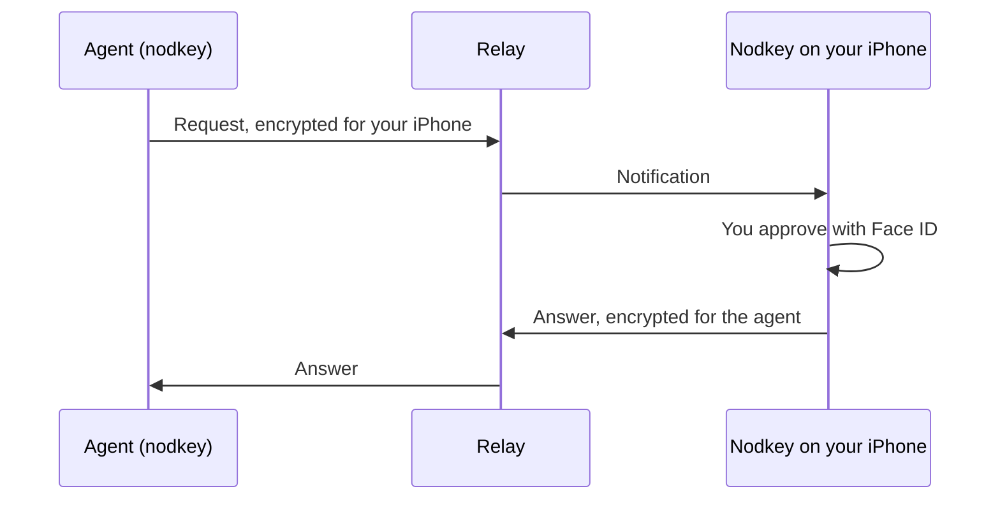

<p align="center">
  
</p>

<h1 align="center">nodkey</h1>

<p align="center">
  Let your coding agents ask your iPhone for a login or a two-step code.<br>
  You approve every request with Face ID.
</p>

<p align="center">
  <a href="https://github.com/peters/nodkey-cli/actions/workflows/ci.yml"></a>
  <a href="LICENSE"></a>
</p>

<p align="center">
  <a href="https://apps.apple.com/app/id6820952672"></a>
</p>

<p align="center">
  
</p>

`nodkey` lets you and your coding agents ask [Nodkey](https://kh-labs.dev/nodkey/) on your iPhone
for **one** one-time code or **one** login at a time. Every request shows up on your phone, and
nothing leaves it until you approve with Face ID (or a lease you set answers for you). The relay in
the middle only forwards encrypted messages.

One small binary does two jobs:

- **A command line** for your terminal and your scripts: `nodkey code`, `nodkey login`, ...
- **An MCP server** for coding agents: `nodkey mcp`. `nodkey setup` adds it to Claude Code, Codex,
  Cursor and Claude Desktop, together with a skill that teaches them how to use it.

Each agent pairs with its own name ("Claude Code @ my-laptop", "Codex @ my-laptop",
"Terminal @ my-laptop"). In Nodkey you see who asked for what, and you can pause or remove one agent
without touching the others.

## Meet Nodkey

<p align="center">
  
  
  
  
</p>

[Nodkey](https://apps.apple.com/app/id6820952672) is a free password manager and authenticator for
iPhone:

- **Passwords, two-step codes and passkeys** behind Face ID, filled in with AutoFill in Safari and
  apps.
- **Agents sign in, you decide.** You see who asks, for which site and why, and approve with Face
  ID. Lend an account for a day or a week, pause an agent, or stop all agents with one tap.
- **Move in in minutes** from Apple Passwords, 1Password, Bitwarden, Chrome, Firefox and more.
  Export everything again at any time.
- **Backed up in your own iCloud**, end-to-end encrypted.
- **No account, no ads, no tracking.** In 12 languages.

## How it works



The relay forwards sealed messages and sends the notification. It cannot read a code, a password,
an account name or the reason.

## What you need

- An iPhone with iOS 18 or later and [Nodkey](https://apps.apple.com/app/id6820952672) from the
  App Store (free).
- Linux, macOS or Windows for `nodkey`.

## Install

> The first public release is on its way. Until it is out, build `nodkey` with Rust (see below).

```sh
curl -fsSL https://raw.githubusercontent.com/peters/nodkey-cli/main/install.sh | sh
```

On Windows (PowerShell):

```powershell
irm https://raw.githubusercontent.com/peters/nodkey-cli/main/install.ps1 | iex
```

Or build it with Rust 1.85 or newer:

```sh
cargo install --locked --git https://github.com/peters/nodkey-cli nodkey
```

The binaries are static (Linux x64 and arm64, macOS arm64 and x64, Windows x64). macOS binaries are
signed and notarized. TLS uses rustls, so no OpenSSL is needed.

## Set up your agents

```sh
nodkey setup            # add the MCP server and the skill to every agent it finds
nodkey setup --dry-run  # show what it would change
nodkey setup --remove   # take it all away again (your pairings stay)
```

`setup` uses `claude mcp` and `codex mcp` for Claude Code and Codex, edits `~/.cursor/mcp.json`
and Claude Desktop's `claude_desktop_config.json`, and writes the skill to `~/.claude/skills`,
`~/.codex/skills` and `~/.agents/skills` (only for the folders that exist). Agents that are not
installed are skipped. Restart the agents afterwards, then ask each one to pair with Nodkey.

Any other MCP client can start the server itself:

```json
{ "mcpServers": { "nodkey": { "command": "nodkey", "args": ["mcp", "--agent", "my-agent"] } } }
```

## Pair

```sh
nodkey pair
```

It shows a code like `K7P-2QX`. In Nodkey, open **Agents**, tap **Add agent** and type the code.
Then `nodkey pair` shows a check number like `418 902`, and so does your iPhone. If the numbers are
not the same, someone may have swapped keys: run `nodkey unpair PHONE` and remove the agent in Nodkey.

An agent pairs the same way with its `pair` tool: it shows you the code, then the check number.

## Use it from the terminal

```sh
nodkey code github.com/alex --reason "Merge PR #42" --field code
nodkey login vg.no --reason "Check my subscription"
nodkey pay shop.example.com 499 NOK --reveal --reason "Buy the cable I asked for"
nodkey accounts
nodkey cleanup --ip-only --reason "Remove logins for old router addresses"
nodkey cleanup --query '*.old-company.example' --last-used-before 2022-01-01 --reason "Old job"
nodkey phones
nodkey agents
```

- The target is a site or an issuer, optionally with `/account`: `github.com/alex`, `vg.no`, `GitHub`.
- The reason is shown on your lock screen. Say plainly why.
- `code` and `login` print JSON, or one field with `--field`. `--image FILE` adds a picture (PNG,
  JPEG or GIF, at most 1 MiB) to the notification.
- `cleanup` only proposes. Your iPhone shows the matching logins and you confirm with Face ID. They go
  to Recently deleted, where you can get them back for 30 days.
- `pay` spends money: it asks your iPhone for your card for one purchase, and your iPhone shows the
  shop and the amount. It works only if you turned on "full card number" for that agent in Nodkey,
  and never above the limit you set for it.
- Exit codes: 0 approved, 1 error, 2 denied, 3 no answer in time, 64 bad arguments. `pay` also has
  5 above your limit, 6 full card numbers off, 7 cards off.
- `nodkey webauthn` is for browser hosts such as Horizon: it reads one passkey request (sign in or
  create) as JSON on stdin and writes the result as JSON on stdout. Your iPhone shows the site and
  signs with a passkey that never leaves it. `nodkey card-fill` gives such a host your card to fill
  a checkout form, so the agent never sees the number. See `docs/agent-protocol.md`.

`nodkey --help` lists every option.

## MCP tools

| Tool | What it does |
| --- | --- |
| `request_code` | one current one-time code for an account |
| `request_login` | user name and password (and a code, if the login has one) |
| `request_credentials` | everything a task needs in one request: up to 10 logins, codes and passkeys; with a session, the rest of the task does not ask again |
| `end_session` | end the task session when the task is done |
| `request_payment` | spends money: your card for one purchase at a shop, for an exact amount |
| `list_accounts` | the accounts this agent may ask for, without secrets |
| `cleanup_insights` | anonymous numbers to suggest clean-up rules from |
| `cleanup_logins` | propose moving matching saved logins to Recently deleted |
| `pair`, `list_phones`, `unpair` | pair this agent, see its phones, leave a phone |

## Settings

| Setting | Default |
| --- | --- |
| Relay: `--relay URL`, else `NODKEY_RELAY`, else `relay` in `config.json` in the agent folder | `https://relay.nodkey.app` |
| Agent identity: `--agent NAME`, else `NODKEY_AGENT` | `terminal` for the command line; for `nodkey mcp`, the MCP client |
| Agent folder: `NODKEY_AGENT_DIR` | `~/.config/nodkey-agent` |
| `NODKEY_REQUEST_TIMEOUT` / `NODKEY_PAIR_TIMEOUT` (seconds) | 120 / 300 |

The agent folder (only you can open it) holds one folder per agent under `agents/` with its keys
(`identity.json`), paired phones (`phones.json`) and, while one runs, the task session
(`session.json`: its id and end, never a secret).

## Security

- An agent never gets a two-step key, only one code at a time, and a password only for the request
  that asked for it. `nodkey` never writes a code or a password to disk or to a log.
- Every relay call is signed with the agent's Ed25519 key. Requests, answers and pictures are
  encrypted to the other side with HPKE (X25519, HKDF-SHA256, ChaCha20-Poly1305). The relay sees no
  code, password, account name, reason or picture.
- Anyone who can read an agent's `identity.json` can ask your phone as that agent. You still have to
  approve, but keep the folder private. To cut an agent off, remove it under Agents in Nodkey.
- A tool result goes to the model. The skill tells agents to use a secret only for the task at hand.
- Cards are off for every agent until you turn them on. Each payment needs Face ID; there is no
  "always allow" for cards, and your iPhone refuses by itself above the limit you set.

The protocol is in [docs/agent-protocol.md](docs/agent-protocol.md). To report a security problem,
see [SECURITY.md](SECURITY.md).

## Related

- [Nodkey for Firefox and Chromium](https://github.com/peters/nodkey-browser): the browser
  extension. It uses the same protocol code, compiled to WebAssembly.
- [kh-labs.dev/nodkey](https://kh-labs.dev/nodkey/): the app's website.

## License

[MIT](LICENSE)
